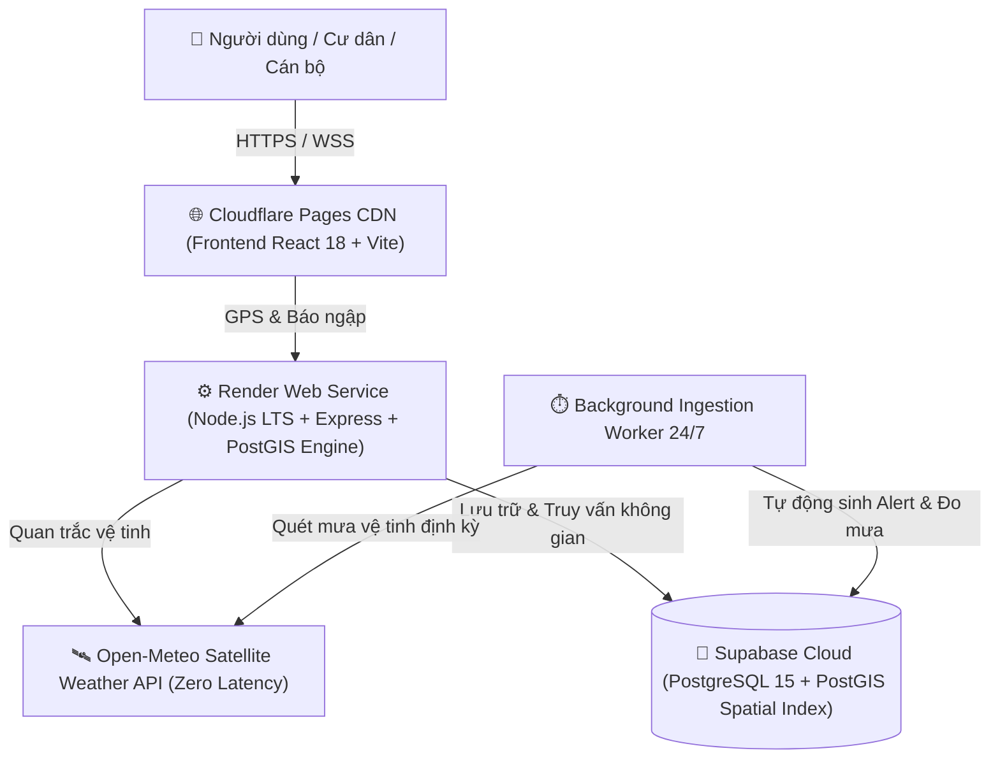

# VIETNAM FLOODWATCH GIS
### HỆ THỐNG WEBGIS GIÁM SÁT THỜI GIAN THỰC, VIỄN THÁM VỆ TINH & CẢNH BÁO BÃO LŨ TOÀN QUỐC
*(Trọng tâm Rốn Lũ Miền Trung & Các Đô Thị Trọng Điểm)*

**Cấp độ đề tài:** Đồ án Chuyên ngành Phát triển & Thiết kế Phần mềm (PTTKPM) / Hệ thống Thông tin Địa lý (GIS)  
**Kho lưu trữ:** [https://github.com/datwhite21/Hanoi-FloodWatch-GIS](https://github.com/datwhite21/Hanoi-FloodWatch-GIS)  

---

### 🌐 ĐỊA CHỈ TRUY CẬP TRỰC TUYẾN CHÍNH THỨC (24/7)
- 🗺️ **Hệ thống WebGIS Trực tuyến (Frontend Cloudflare):** [https://hanoi-floodwatch-gis.pages.dev](https://hanoi-floodwatch-gis.pages.dev)
- 📡 **Máy chủ Dịch vụ Không gian (Backend Render):** [https://hanoi-floodwatch-gis-1.onrender.com](https://hanoi-floodwatch-gis-1.onrender.com)
- 🩺 **Kiểm tra tình trạng máy chủ (Health Check):** [https://hanoi-floodwatch-gis-1.onrender.com/api/health](https://hanoi-floodwatch-gis-1.onrender.com/api/health)
- 🛰️ **API Thời tiết Vệ tinh Động (Open-Meteo Feed):** [https://hanoi-floodwatch-gis-1.onrender.com/api/weather/current?lat=16.4637&lng=107.5909](https://hanoi-floodwatch-gis-1.onrender.com/api/weather/current?lat=16.4637&lng=107.5909)
- 📋 **Hồ sơ Kết quả Kiểm thử Toàn trình (100% PASS):** [docs/testing/TEST_RESULTS.md](docs/testing/TEST_RESULTS.md)
- 📖 **Cẩm nang Hướng dẫn Sử dụng Chi tiết:** [docs/USER_GUIDE.md](docs/USER_GUIDE.md)
- 📑 **Báo cáo Tổng kết Đồ án 5 Chương:** [docs/reports/PROJECT_REPORT.md](docs/reports/PROJECT_REPORT.md)

---

## 1. TỔNG QUAN & TÍNH CẤP THIẾT CỦA ĐỀ TÀI
Việt Nam là quốc gia chịu ảnh hưởng nặng nề bởi thiên tai bão lũ, đặc biệt là **dải đất Miền Trung (Thừa Thiên Huế, Quảng Trị, Quảng Bình, Hà Tĩnh, Đà Nẵng, Quảng Nam)** – nơi được mệnh danh là "rốn lũ" của cả nước với lượng mưa có thể đạt 500 – 1.000 mm/đợt, gây ngập lụt diện rộng và cô lập các khu dân cư. Đồng thời tại các siêu đô thị như **Hà Nội** và **TP. Hồ Chí Minh**, triều cường kết hợp mưa lớn cục bộ liên tục gây ngập úng nghiêm trọng, làm đình trệ giao thông và thiệt hại kinh tế.

Hệ thống **Vietnam FloodWatch GIS** được nghiên cứu và phát triển nhằm mục tiêu giải quyết bài toán trên bằng cách:
1. **Dữ liệu Thực tế 100% (Clean Slate Architecture):** CSDL hoàn toàn sạch ban đầu (0 bản ghi giả lập/mock). Dữ liệu tự động phát sinh và vận động liên tục theo thời gian thực từ 2 nguồn: Vệ tinh viễn thám khí tượng và Báo cáo cộng đồng của người dân.
2. **Viễn thám Vệ tinh Khí tượng Tự động (Satellite Weather Dynamic Feed):** Tích hợp dịch vụ vệ tinh Open-Meteo cập nhật lượng mưa theo giờ (mm/h), nhiệt độ, độ ẩm, sức gió và mã thời tiết chuẩn WMO tự động theo tọa độ GPS của người dùng tại bất kỳ đâu trên lãnh thổ Việt Nam.
3. **Tiến trình Quan trắc Tự động Chạy ngầm (Background Ingestion Worker 24/7):** Quét định kỳ các trạm khí tượng thủy văn trọng điểm toàn quốc (Huế, Lệ Thủy, Đông Hà, Đà Nẵng, Hương Khê, Hà Nội, TP.HCM). Khi ghi nhận mưa lớn vượt ngưỡng (≥ 20mm/h hoặc ≥ 50mm/h), hệ thống tự động ghi nhật ký đo mưa (`rainfall_observations`) và phát sinh cảnh báo cấp bách (`flood_alerts`) với mốc thời gian thực tế `NOW()`.
4. **Mạng lưới Báo ngập Cộng đồng (Citizen Crowdsourcing):** Cho phép người dân tại hiện trường sử dụng điện thoại thông minh định vị GPS, phản ánh trực quan độ sâu nước (Mắt cá chân ~15cm, Nửa bánh xe máy ~35cm, Ngập lũ sâu > 1m) kèm mô tả và hình ảnh. Điểm ngập được hiển thị tức thì lên bản đồ với hiệu ứng sóng radar nhấp nháy đồng bộ qua WebSockets.
5. **Phân tích Không gian Chuyên sâu (Spatial GIS Analytics):** Ứng dụng PostgreSQL/PostGIS thực hiện truy vấn bán kính vùng ngập an toàn `ST_DWithin` và tìm kiếm điểm cảnh báo gần nhất bằng thuật toán k-Nearest Neighbors (`<->`).

---

## 2. KIẾN TRÚC HỆ THỐNG (3-TIER DECOUPLED CLOUD)

1. **Frontend (Tầng Trình diễn):** React 18, TypeScript, Tailwind CSS, Leaflet GIS, Leaflet MarkerCluster, Recharts, Lucide Icons. Tích hợp chuyển đổi linh hoạt nhiều lớp bản đồ nền (Google Maps, Google Satellite, CartoDB Voyager, Esri Satellite, OpenStreetMap) đảm bảo hoạt động thông suốt không bị chặn tại Việt Nam.
2. **Backend (Tầng Nghiệp vụ):** Node.js LTS, Express.js, TypeScript, RESTful API chuẩn, Zod Validation, Supabase Service Role API, Ingestion Background Worker.
3. **Database (Tầng Dữ liệu Không gian):** PostgreSQL 15+ trên Supabase Cloud, tiện ích mở rộng PostGIS, hệ tọa độ chuẩn WGS 84 (EPSG:4326), chỉ mục không gian `GiST`, chính sách bảo vệ an toàn `Row Level Security (RLS)`.

---

## 3. DANH SÁCH BỘ LỌC VÙNG MIỀN TOÀN QUỐC
Hệ thống cho phép người dùng chuyển nhanh tiêu điểm quan sát trên bản đồ:
- 🇻🇳 **Toàn quốc (Toàn cảnh Việt Nam):** Tọa độ trung tâm `[16.0544, 108.2022]`, Zoom cấp 6.
- 🔴 **Rốn Lũ Miền Trung:** Tọa độ Thừa Thiên Huế & Quảng Trị `[16.4637, 107.5909]`, Zoom cấp 9. Trọng tâm giám sát bão lũ các tỉnh: Huế, Quảng Trị, Quảng Bình (Lệ Thủy), Hà Tĩnh (Hương Khê), Đà Nẵng, Quảng Nam.
- 🏛️ **Miền Bắc (Hà Nội):** Tọa độ `[21.0285, 105.8542]`, Zoom cấp 12. Theo dõi các điểm ngập cục bộ tại Cầu Giấy, Thanh Xuân, Hà Đông, Hai Bà Trưng.
- 🏙️ **Miền Nam (TP. Hồ Chí Minh):** Tọa độ `[10.8231, 106.6297]`, Zoom cấp 11. Theo dõi các điểm ngập triều cường tại Quận 7, Nhà Bè, Thủ Đức, Bình Thạnh.

---

## 4. HƯỚNG DẪN DÀNH CHO NGƯỜI DÙNG & HỘI ĐỒNG
- Chi tiết hướng dẫn vận hành, kiểm tra GPS thời tiết và gửi báo cáo ngập: xem [docs/USER_GUIDE.md](docs/USER_GUIDE.md).
- Chi tiết hướng dẫn cấu hình bảng CSDL trên Supabase: xem [docs/SUPABASE_MIGRATION_GUIDE.md](docs/SUPABASE_MIGRATION_GUIDE.md).
- Toàn bộ kết quả kiểm thử đạt 100% PASS: xem [docs/testing/TEST_RESULTS.md](docs/testing/TEST_RESULTS.md).
- Báo cáo tổng kết đồ án PTTKPM 5 chương: xem [docs/reports/PROJECT_REPORT.md](docs/reports/PROJECT_REPORT.md).
