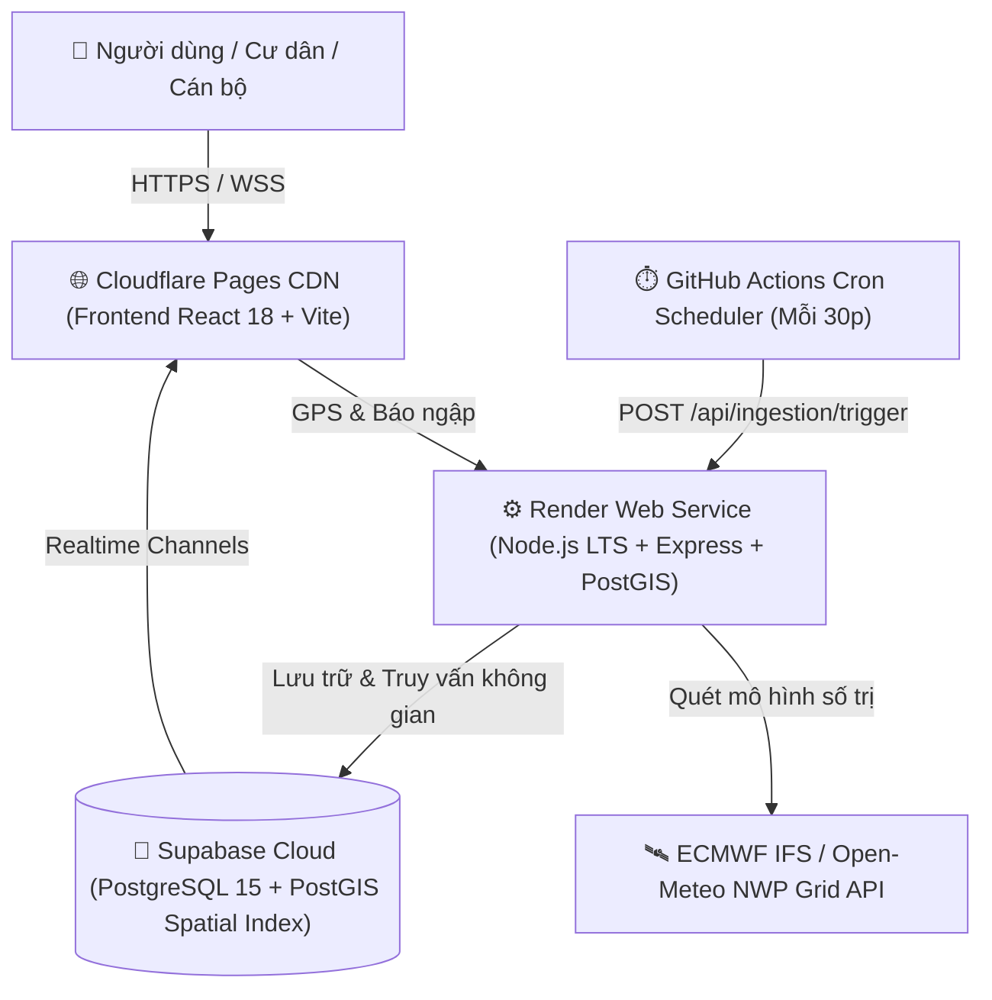

# VIETNAM FLOODWATCH GIS
### HỆ THỐNG WEBGIS GIÁM SÁT THỜI GIAN THỰC, VIỄN THÁM VỆ TINH & CẢNH BÁO BÃO LŨ TOÀN QUỐC
*(Trọng tâm Rốn Lũ Miền Trung & Các Đô Thị Trọng Điểm)*

**Cấp độ đề tài:** Đồ án Chuyên ngành Phát triển & Thiết kế Phần mềm (PTTKPM) / Hệ thống Thông tin Địa lý (GIS)  
**Kho lưu trữ:** [https://github.com/datwhite21/Hanoi-FloodWatch-GIS](https://github.com/datwhite21/Hanoi-FloodWatch-GIS)  

---

### 🌐 ĐỊA CHỈ TRUY CẬP TRỰC TUYẾN CHÍNH THỨC (24/7)
- 🗺️ **Hệ thống WebGIS Trực tuyến (Frontend Cloudflare):** [https://hanoi-floodwatch-gis.pages.dev](https://hanoi-floodwatch-gis.pages.dev)
- 📡 **Máy chủ Dịch vụ Không gian (Backend Render):** [https://hanoi-floodwatch-gis-1.onrender.com](https://hanoi-floodwatch-gis-1.onrender.com)
- 🩺 **Kiểm tra tình trạng máy chủ (Health Check):** [https://hanoi-floodwatch-gis-1.onrender.com/api/health](https://hanoi-floodwatch-gis-1.onrender.com/api/health)
- 🛰️ **API Thời tiết Vệ tinh Động (Open-Meteo Feed):** [https://hanoi-floodwatch-gis-1.onrender.com/api/weather/current?lat=16.4637&lng=107.5909](https://hanoi-floodwatch-gis-1.onrender.com/api/weather/current?lat=16.4637&lng=107.5909)
- 📋 **Báo cáo Kiểm toán Dữ liệu Thực tế (Audit Report):** [docs/REALTIME_DATA_AUDIT.md](docs/REALTIME_DATA_AUDIT.md)
- 📐 **Thiết kế Pipeline Dữ liệu Động & Idempotency:** [docs/DATA_PIPELINE.md](docs/DATA_PIPELINE.md)
- ⚠️ **Phương pháp luận Đánh giá & Phân loại Cảnh báo:** [docs/ALERT_METHODOLOGY.md](docs/ALERT_METHODOLOGY.md)
- 🔑 **Cẩm nang Thiết lập Thủ công Dịch vụ Ngoài:** [docs/MANUAL_SETUP_GUIDE.md](docs/MANUAL_SETUP_GUIDE.md)
- 📋 **Hồ sơ Kết quả Kiểm thử Toàn trình (100% PASS):** [docs/testing/TEST_RESULTS.md](docs/testing/TEST_RESULTS.md)
- 📖 **Cẩm nang Hướng dẫn Sử dụng Chi tiết:** [docs/USER_GUIDE.md](docs/USER_GUIDE.md)
- 📑 **Báo cáo Tổng kết Đồ án 5 Chương:** [docs/reports/PROJECT_REPORT.md](docs/reports/PROJECT_REPORT.md)

---

## 1. TỔNG QUAN & TÍNH CẤP THIẾT CỦA ĐỀ TÀI
Việt Nam là quốc gia chịu ảnh hưởng nặng nề bởi thiên tai bão lũ, đặc biệt là **dải đất Miền Trung (Thừa Thiên Huế, Quảng Trị, Quảng Bình, Hà Tĩnh, Đà Nẵng, Quảng Nam)** – nơi được mệnh danh là "rốn lũ" của cả nước với lượng mưa có thể đạt 500 – 1.000 mm/đợt, gây ngập lụt diện rộng và cô lập các khu dân cư. Đồng thời tại các siêu đô thị như **Hà Nội** và **TP. Hồ Chí Minh**, triều cường kết hợp mưa lớn cục bộ liên tục gây ngập úng nghiêm trọng, làm đình trệ giao thông và thiệt hại kinh tế.

Hệ thống **Vietnam FloodWatch GIS** được nghiên cứu và phát triển theo các nguyên tắc học thuật nghiêm ngặt:
1. **Dữ liệu Thực tế 100% (Zero Mock Data):** Không sử dụng dữ liệu giả lập (mock fallback). Mọi bản ghi đều có mốc thời gian kiểm chứng (`observed_at`, `valid_at`, `fetched_at`) và được gán nhãn trạng thái minh bạch (`LIVE_FRESH`, `STALE`, `DRY`, `NO_DATA`).
2. **Mô hình Khí tượng Số trị ECMWF IFS (Numerical Weather Prediction):** Tích hợp nguồn cấp dữ liệu mô hình toàn cầu ECMWF qua Open-Meteo cập nhật lượng mưa theo giờ (mm/h), nhiệt độ, độ ẩm, sức gió và mã WMO chuẩn hóa với độ phân giải lưới ~9km. Phân định rạch ròi giữa số liệu mô hình số trị nội suy và trạm quan trắc mặt đất vật lý.
3. **Pipeline Thu thập Độc lập (GitHub Actions Cron + Idempotency):** Khắc phục triệt để hiện tượng ngủ đông của Render Free Tier bằng GitHub Actions Cron Workflow (`.github/workflows/ingestion-cron.yml`) định kỳ kích hoạt endpoint `/api/ingestion/trigger`, lưu nhật ký vào `ingestion_logs` và ngăn chặn trùng lặp qua ràng buộc duy nhất trên CSDL.
4. **Phương pháp luận Cảnh báo 4 Cấp độ:** Thay vì tự tiện phát cảnh báo đỏ với ngưỡng cứng 20 mm/h, hệ thống phân loại khoa học: Loại 1 (Chỉ số mưa lớn thử nghiệm kỹ thuật), Loại 2 (Báo cáo cộng đồng chưa kiểm chứng), Loại 3 (Điểm ngập đã xác minh hiện trường), Loại 4 (Bản tin chỉ đạo chính thức từ cơ quan KTTV).
5. **Mạng lưới Báo ngập Cộng đồng (Citizen Crowdsourcing):** Cho phép người dân tại hiện trường sử dụng điện thoại thông minh định vị GPS, phản ánh trực quan độ sâu nước (Mắt cá chân ~15cm, Nửa bánh xe máy ~35cm, Ngập lũ sâu > 1m) kèm mô tả và hình ảnh. Điểm ngập được hiển thị tức thì lên bản đồ với hiệu ứng sóng radar nhấp nháy đồng bộ qua WebSockets.
6. **Bản đồ nền Hợp pháp & GIS Chuẩn PostGIS:** Sử dụng CartoDB Voyager làm lớp bản đồ hiển thị mặc định, hỗ trợ Esri Satellite và OpenStreetMap, thực hiện truy vấn bán kính `ST_DWithin` và tìm kiếm lân cận k-NN (`<->`) theo chuẩn EPSG:4326.

---

## 2. KIẾN TRÚC HỆ THỐNG (DECOUPLED HYBRID CLOUD)

1. **Frontend (Tầng Trình diễn):** React 18, TypeScript, Tailwind CSS, Leaflet GIS, Recharts, Lucide Icons. Lớp bản đồ mặc định CartoDB Voyager hợp pháp, tốc độ cao.
2. **Backend (Tầng Nghiệp vụ):** Node.js LTS, Express.js, TypeScript, Zod Validation, Supabase Service Role API, Ingestion Controller & Worker.
3. **Database (Tầng Dữ liệu Không gian):** PostgreSQL 15+ trên Supabase Cloud, PostGIS extension, WGS 84 (EPSG:4326), chỉ mục không gian `GiST`, chính sách bảo vệ `Row Level Security (RLS)`.
4. **Automation Scheduler:** GitHub Actions Workflow chạy định kỳ 24/7 đánh thức Render và thu thập dữ liệu định kỳ.

---

## 3. DANH SÁCH BỘ LỌC VÙNG MIỀN TOÀN QUỐC
Hệ thống cho phép người dùng chuyển nhanh tiêu điểm quan sát trên bản đồ:
- 🇻🇳 **Toàn quốc (Toàn cảnh Việt Nam):** Tọa độ trung tâm `[16.0544, 108.2022]`, Zoom cấp 6.
- 🔴 **Rốn Lũ Miền Trung:** Tọa độ Thừa Thiên Huế & Quảng Trị `[16.4637, 107.5909]`, Zoom cấp 9. Trọng tâm giám sát bão lũ các tỉnh: Huế, Quảng Trị, Quảng Bình (Lệ Thủy), Hà Tĩnh (Hương Khê), Đà Nẵng, Quảng Nam.
- 🏛️ **Miền Bắc (Hà Nội):** Tọa độ `[21.0285, 105.8542]`, Zoom cấp 12. Theo dõi các điểm ngập cục bộ tại Cầu Giấy, Thanh Xuân, Hà Đông, Hai Bà Trưng.
- 🏙️ **Miền Nam (TP. Hồ Chí Minh):** Tọa độ `[10.8231, 106.6297]`, Zoom cấp 11. Theo dõi các điểm ngập triều cường tại Quận 7, Nhà Bè, Thủ Đức, Bình Thạnh.

---

## 4. HƯỚNG DẪN DÀNH CHO HỘI ĐỒNG BẢO VỆ & HƯỚNG DẪN VẬN HÀNH
- **Hướng dẫn thiết lập thủ công các dịch vụ ngoài:** Xem [docs/MANUAL_SETUP_GUIDE.md](docs/MANUAL_SETUP_GUIDE.md).
- **Hướng dẫn chạy migration CSDL an toàn:** Xem [docs/SUPABASE_MIGRATION_GUIDE.md](docs/SUPABASE_MIGRATION_GUIDE.md) và file [database/migrations/03_enhanced_schema.sql](database/migrations/03_enhanced_schema.sql).
- **Hồ sơ kiểm thử và minh chứng 100% PASS:** Xem [docs/testing/TEST_RESULTS.md](docs/testing/TEST_RESULTS.md).
- **Báo cáo tổng kết đồ án PTTKPM 5 chương:** Xem [docs/reports/PROJECT_REPORT.md](docs/reports/PROJECT_REPORT.md).
- **Slide tóm tắt bảo vệ đồ án:** Xem [docs/presentation/SLIDES.md](docs/presentation/SLIDES.md).
