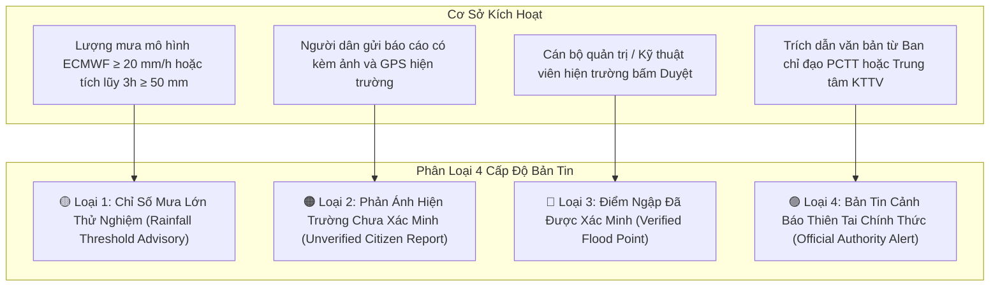

# PHƯƠNG PHÁP LUẬN ĐÁNH GIÁ NGUY CƠ & PHÂN LOẠI CẢNH BÁO
# (FLOOD RISK ASSESSMENT & ALERT METHODOLOGY)
## DỰ ÁN: VIETNAM FLOODWATCH GIS

---

## 1. NGUYÊN TẮC LIÊM CHÍNH TRONG CẢNH BÁO THIÊN TAI

> **TUYÊN BỐ PHÁP LÝ & KHOA HỌC:**
> 1. Hệ thống **Vietnam FloodWatch GIS** là sản phẩm nghiên cứu khoa học thuộc đồ án đại học, đóng vai trò công cụ **hỗ trợ theo dõi, mô phỏng và nghiên cứu không gian**.
> 2. Hệ thống **KHÔNG PHẢI** là cơ quan có thẩm quyền ban hành bản tin dự báo thiên tai quốc gia.
> 3. Tuyệt đối không tự tiện gán nhãn "Cảnh báo khẩn cấp" cho các giá trị ngưỡng mưa mô phỏng đơn lẻ.
> 4. Mọi thông tin cảnh báo hiển thị trên giao diện đều phải ghi rõ nguồn gốc, phương pháp sinh cảnh báo và mức độ tin cậy.

---

## 2. PHÂN LOẠI 4 CẤP ĐỘ CẢNH BÁO CÓ CĂN CỨ

Thay vì gộp tất cả thành một nhãn "Khẩn cấp" chung chung, hệ thống phân định rạch ròi 4 cấp độ cảnh báo với màu sắc và quy tắc hiển thị riêng biệt:

### 🔹 Loại 1: Chỉ Số Theo Dõi Mưa Lớn Thử Nghiệm (Rainfall Threshold Advisory)
- **Cơ sở kích hoạt:** Lượng mưa từ mô hình số trị ECMWF/Open-Meteo vượt ngưỡng kỹ thuật:
  - Mức Theo Dõi (Vàng): Khi lượng mưa theo giờ đạt `15 - 30 mm/h`.
  - Mức Chú Ý (Cam): Khi lượng mưa theo giờ đạt `> 30 mm/h` hoặc mưa dồn dập.
- **Quy tắc hiển thị:** 
  - Ghi rõ tiêu đề: `[Tham khảo Kỹ thuật] Khu vực ghi nhận mưa lớn mô hình [Tên khu vực]`.
  - Nội dung phải có dòng chú thích bắt buộc: *"Số liệu dựa trên mô hình số trị Open-Meteo/ECMWF. Nguy cơ ngập úng thực tế phụ thuộc vào năng lực thoát nước và địa hình cục bộ."*
  - **Không gửi thông báo đẩy khẩn cấp** làm hoang mang người dân.

### 🔹 Loại 2: Phản Ánh Hiện Trường Chưa Xác Minh (Unverified Citizen Report)
- **Cơ sở kích hoạt:** Người dân tại hiện trường gửi báo cáo qua chức năng `📢 Báo ngập`.
- **Quy tắc hiển thị:**
  - Marker trên bản đồ có màu cam viền đứt nét nhấp nháy, kèm biểu tượng `📢`.
  - Nhãn hiển thị: `[Cộng đồng] Chưa qua kiểm chứng`.
  - Hiển thị số lượt đồng thuận (`👍 upvotes`) từ những người xung quanh để tăng độ tin cậy cộng đồng.

### 🔹 Loại 3: Điểm Ngập Đã Được Xác Minh (Verified Flood Point)
- **Cơ sở kích hoạt:** Cán bộ quản lý hoặc Admin kỹ thuật sau khi kiểm tra bằng chứng hình ảnh hiện trường, bấm nút **Xác minh (Verify)** trong trang Quản trị.
- **Quy tắc hiển thị:**
  - Marker chuyển thành màu đỏ đặc (nếu ngập sâu > 40cm) hoặc màu cam (20 - 40cm).
  - Nhãn hiển thị: `[Đã xác minh] Điểm ngập úng hiện trường`.

### 🔹 Loại 4: Bản Tin Cảnh Báo Thiên Tai Chính Thức (Official Authority Alert)
- **Cơ sở kích hoạt:** Bản tin trích dẫn nguyên văn từ các cơ quan có thẩm quyền: Ban Chỉ đạo Quốc gia về Phòng chống Thiên tai, Trung tâm Dự báo Khí tượng Thủy văn Quốc gia, Đài KTTV khu vực Miền Trung...
- **Quy tắc hiển thị:**
  - Băng chữ chạy màu đỏ phía trên Dashboard: `[Cảnh báo Chính thức] [Tên cơ quan ban hành]`.
  - Bắt buộc phải có trường `source_document_url` hoặc số hiệu văn bản chỉ đạo.

---

## 3. ĐIỀU CHỈNH LOGIC NGƯỠNG MƯA 20 MM/H CŨ

- **Vấn đề của logic cũ:** Trước đây, hệ thống tự động sinh cảnh báo khẩn cấp khi `precipitation_mm_h >= 20`. Ngưỡng này là giả định kỹ thuật thô, bởi vì:
  - Tại các đô thị có hạ tầng thoát nước tốt, mưa 20 mm/h có thể tiêu thoát bình thường.
  - Tại các vùng trũng Miền Trung (như Lệ Thủy, Phong Điền), ngập lũ chủ yếu do **nước lũ từ thượng nguồn đổ về kết hợp triều cường**, chứ không đơn thuần chỉ do mưa tại chỗ.
- **Điều chỉnh trong phiên bản nâng cấp:**
  1. Giữ ngưỡng 20 mm/h làm **ngưỡng kích hoạt nhật ký theo dõi (Advisory Trigger)**, không phát sinh cảnh báo đỏ.
  2. Bổ sung tính toán **lượng mưa tích lũy 3 giờ và 6 giờ (Cumulative Precipitation)** để đánh giá nguy cơ bão hòa đất và dâng nước lũ.
  3. Khi chưa đủ dữ liệu địa hình hoặc lưu vực: Hệ thống hiển thị rõ ràng trạng thái *"Chưa đủ dữ liệu để tính toán ngập lụt"* thay vì tự gán điểm nguy cơ giả.
