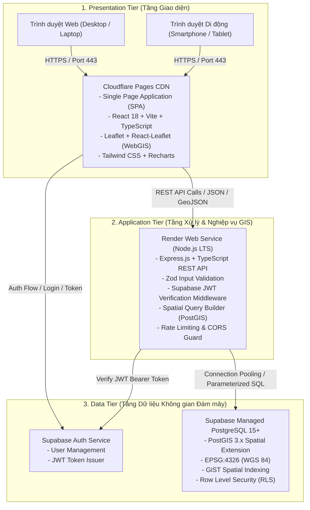
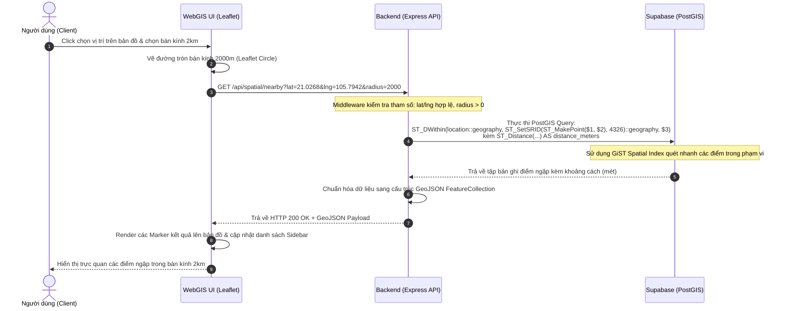

# KIẾN TRÚC HỆ THỐNG (SYSTEM ARCHITECTURE)
## DỰ ÁN: HANOI FLOODWATCH GIS

---

## 1. TỔNG QUAN KIẾN TRÚC 3 TẦNG (3-TIER ARCHITECTURE)

Hệ thống **Hanoi FloodWatch GIS** được thiết kế theo mô hình kiến trúc phân tầng hiện đại, phân tách độc lập giữa Giao diện người dùng (Presentation Tier), Tầng xử lý nghiệp vụ & GIS (Application/Logic Tier) và Tầng dữ liệu không gian đám mây (Data Tier).

---

## 2. CHI TIẾT CÁC TẦNG CÔNG NGHỆ

### 2.1. Tầng Giao diện (Presentation Tier - Cloudflare Pages)
- **Công nghệ:** React 18, Vite, TypeScript, Tailwind CSS, Lucide React (Icons), Recharts (Biểu đồ).
- **Thư viện GIS:** Leaflet 1.9+, React-Leaflet.
- **Nguồn bản đồ nền:** OpenStreetMap (OSM) Standard Tile Layer via HTTPS.
- **Tính năng nổi bật:**
  - Định dạng chuẩn dữ liệu bản đồ: `GeoJSON (RFC 7946)`.
  - Client-side Rendering (CSR) tối ưu, phản hồi tức thời.
  - Tự động thích ứng đa màn hình (Responsive Design).
  - Bản đồ tương tác hỗ trợ click chọn tọa độ, vẽ đường tròn bán kính, layer toggle.

### 2.2. Tầng Nghiệp vụ & GIS (Application Tier - Render)
- **Công nghệ:** Node.js LTS, Express.js, TypeScript.
- **Mô hình tổ chức mã nguồn:** Clean Layered Architecture:
  - `controllers/`: Tiếp nhận HTTP Request, trích xuất tham số, gọi Service, trả về HTTP Response chuẩn.
  - `services/`: Xử lý logic nghiệp vụ, tính toán điểm nguy cơ (RiskScore), điều phối truy vấn không gian.
  - `repositories/`: Tương tác trực tiếp với PostgreSQL/PostGIS thông qua SQL tham số hóa (Parameterized queries với `pg` pool).
  - `middlewares/`: Kiểm tra JWT, phân quyền Admin/Public, validate schema bằng Zod, bắt lỗi tập trung (Error Handler), giới hạn tần suất gọi (Rate Limiting).
- **Tính năng GIS chuyên sâu:**
  - Không tính khoảng cách Euclid thông thường trên độ (degree).
  - Ép kiểu không gian sang `geography` để tính toán chính xác theo đơn vị mét/kilômét trên bề mặt cầu elipsoid Trái Đất (WGS 84).

### 2.3. Tầng Dữ liệu Không gian (Data Tier - Supabase Cloud)
- **Hệ quản trị CSDL:** PostgreSQL 15+ tích hợp **PostGIS Extension**.
- **Hệ quy chiếu tọa độ:** WGS 84 (`SRID = 4326`), tương thích trực tiếp với GPS toàn cầu và bản đồ OpenStreetMap.
- **Cơ chế tối ưu hóa truy vấn:**
  - Đánh chỉ mục không gian `USING GIST (location)`.
  - Cơ chế Connection Pooling để tránh quá tải kết nối.
- **An ninh dữ liệu:**
  - Row Level Security (RLS) bảo vệ mức dòng dữ liệu.
  - Tách biệt schema public và bảo vệ bảng nhạy cảm.

---

## 3. LUỒNG XỬ LÝ TRUY VẤN KHÔNG GIAN (SPATIAL QUERY WORKFLOW)

---

## 4. CHIẾN LƯỢC TRIỂN KHAI & TỐI ƯU GÓI MIỄN PHÍ (FREE-TIER CLOUD)

1. **Khắc phục tình trạng "Ngủ đông" của Render (Cold Start):**
   - Bản miễn phí của Render sẽ tạm dừng dịch vụ sau 15 phút không có lượt truy cập (mất khoảng 30–50 giây để khởi động lại).
   - *Giải pháp:* Thiết lập endpoint `/api/health` trả về trạng thái máy chủ nhẹ nhất, đồng thời trên Frontend hiển thị thông báo trạng thái thân thiện khi máy chủ đang "thức dậy" lần đầu.
2. **Khắc phục giới hạn kết nối Supabase:**
   - Sử dụng Supabase Transaction Connection Pooler (Port 6543 hoặc Session Pooler) để quản lý kết nối hiệu quả từ Backend Node.js.
3. **CORS & Domain:**
   - Cấu hình whitelist tên miền nghiêm ngặt trên Render, chỉ cho phép origin từ Cloudflare Pages (`https://*.pages.dev`) và môi trường local development.
