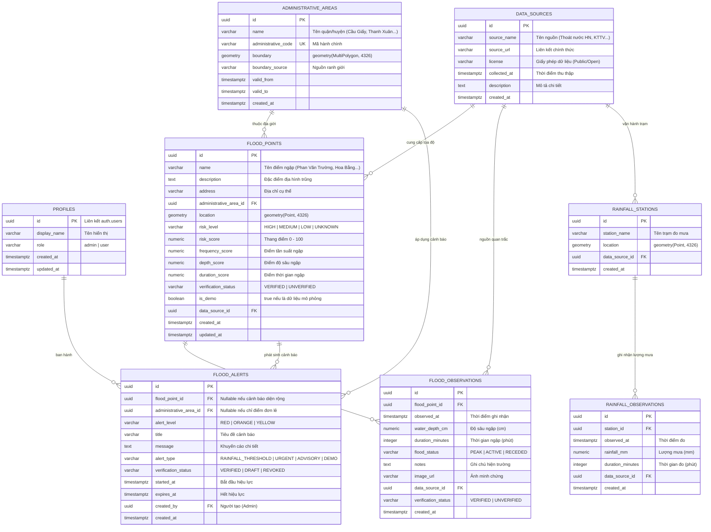

# THIẾT KẾ CƠ SỞ DỮ LIỆU (DATABASE SCHEMA SPECIFICATION)
## DỰ ÁN: HANOI FLOODWATCH GIS
**Hệ quản trị CSDL:** PostgreSQL 15+ trên Supabase Cloud
**Phần mở rộng không gian:** PostGIS 3.x
**Hệ tọa độ chuẩn:** WGS 84 (EPSG:4326)

---

## 1. SƠ ĐỒ THỰC THỂ LIÊN KẾT (MERMAID ERD)



---

## 2. ĐẶC TẢ CHI TIẾT CÁC BẢNG & RÀNG BUỘC (DATA DICTIONARY)

### 2.1. Bảng `profiles`
Lưu trữ thông tin bổ sung cho tài khoản xác thực bởi Supabase Auth (`auth.users`).
- `id` (UUID, PK): Khóa ngoại tham chiếu `auth.users(id)` ON DELETE CASCADE.
- `display_name` (VARCHAR(150), NOT NULL): Tên hiển thị người dùng/cán bộ.
- `role` (VARCHAR(20), NOT NULL, DEFAULT 'user'): `admin` hoặc `user`.

### 2.2. Bảng `administrative_areas`
Lưu trữ địa giới hành chính các quận/huyện của Hà Nội phục vụ truy vấn vùng (`ST_Contains`, `ST_Intersects`).
- `id` (UUID, PK, DEFAULT gen_random_uuid()): Mã định danh vùng.
- `name` (VARCHAR(100), NOT NULL): Tên quận (Ví dụ: "Cầu Giấy", "Thanh Xuân", "Hà Đông").
- `administrative_code` (VARCHAR(20), UNIQUE, NOT NULL): Mã định danh chuẩn hành chính.
- `boundary` (GEOMETRY(MultiPolygon, 4326), NOT NULL): Đa giác ranh giới địa lý.

### 2.3. Bảng `data_sources`
Lưu trữ xuất xứ của dữ liệu nhằm đảm bảo tính minh bạch, phục vụ trích dẫn trong đồ án.
- `id` (UUID, PK, DEFAULT gen_random_uuid())
- `source_name` (VARCHAR(200), NOT NULL): Tên đơn vị/nguồn cấp dữ liệu.
- `source_url` (TEXT): Liên kết kiểm chứng dữ liệu.
- `license` (VARCHAR(100), DEFAULT 'Open Data')

### 2.4. Bảng `flood_points` (Bảng trung tâm hệ thống)
Lưu trữ danh mục các điểm nguy cơ ngập úng với tọa độ không gian chính xác.
- `id` (UUID, PK, DEFAULT gen_random_uuid())
- `name` (VARCHAR(200), NOT NULL): Tên địa điểm ngập.
- `description` (TEXT): Nguyên nhân ngập (trũng thấp, xa cửa xả, tắc cống...).
- `address` (VARCHAR(300), NOT NULL): Địa chỉ đường/phố.
- `administrative_area_id` (UUID, FK): Tham chiếu `administrative_areas(id)`.
- `location` (GEOMETRY(Point, 4326), NOT NULL): Tọa độ không gian (Longitude, Latitude).
- `risk_level` (VARCHAR(20), NOT NULL): Ràng buộc CHECK `risk_level IN ('HIGH', 'MEDIUM', 'LOW', 'UNKNOWN')`.
- `risk_score` (NUMERIC(5,2), CHECK (risk_score >= 0 AND risk_score <= 100))
- `is_demo` (BOOLEAN, NOT NULL, DEFAULT false): Cờ nhận diện dữ liệu mô phỏng.

### 2.5. Bảng `flood_observations`
Lưu lịch sử các lần xảy ra ngập úng thực tế qua từng trận bão/mưa lớn.
- `id` (UUID, PK, DEFAULT gen_random_uuid())
- `flood_point_id` (UUID, FK, NOT NULL): Tham chiếu `flood_points(id)` ON DELETE CASCADE.
- `observed_at` (TIMESTAMPTZ, NOT NULL): Thời điểm đo/ghi nhận.
- `water_depth_cm` (NUMERIC(6,2), CHECK (water_depth_cm >= 0)): Mực nước ngập đo được (cm).
- `duration_minutes` (INTEGER, CHECK (duration_minutes >= 0)): Thời gian ngập kéo dài.
- `flood_status` (VARCHAR(20), CHECK `flood_status IN ('PEAK', 'ACTIVE', 'RECEDED')`)

### 2.6. Bảng `flood_alerts`
Lưu thông tin cảnh báo ngập theo thời gian thực hoặc dự báo theo ngưỡng mưa.
- `id` (UUID, PK, DEFAULT gen_random_uuid())
- `alert_level` (VARCHAR(20), CHECK `alert_level IN ('RED', 'ORANGE', 'YELLOW')`)
- `title` (VARCHAR(250), NOT NULL): Tiêu đề cảnh báo ngắn gọn.
- `message` (TEXT, NOT NULL): Hướng dẫn lộ trình tránh ngập cho người dân.
- `started_at` (TIMESTAMPTZ, NOT NULL, DEFAULT NOW())
- `expires_at` (TIMESTAMPTZ, NOT NULL): Thời hạn kết thúc cảnh báo.

---

## 3. THIẾT LẬP CHỈ MỤC TỐI ƯU HÓA (INDEX STRATEGY)

### 3.1. Chỉ mục Không gian GiST (Spatial GiST Indexes)
Đây là yếu tố kỹ thuật then chốt giúp tăng tốc độ truy vấn bán kính và điểm gần nhất từ hàng nghìn lần so với quét toàn bảng (Full Table Scan):
```sql
-- Chỉ mục GiST cho tọa độ điểm ngập
CREATE INDEX idx_flood_points_location ON flood_points USING GIST (location);

-- Chỉ mục GiST cho ranh giới quận/huyện
CREATE INDEX idx_administrative_areas_boundary ON administrative_areas USING GIST (boundary);

-- Chỉ mục GiST cho trạm đo mưa
CREATE INDEX idx_rainfall_stations_location ON rainfall_stations USING GIST (location);
```

### 3.2. Chỉ mục Quan hệ B-Tree (Relational B-Tree Indexes)
```sql
CREATE INDEX idx_flood_points_area_id ON flood_points(administrative_area_id);
CREATE INDEX idx_flood_points_risk_level ON flood_points(risk_level);
CREATE INDEX idx_flood_observations_point_id ON flood_observations(flood_point_id);
CREATE INDEX idx_flood_observations_observed_at ON flood_observations(observed_at DESC);
CREATE INDEX idx_flood_alerts_active ON flood_alerts(expires_at DESC) WHERE verification_status = 'VERIFIED';
```

---

## 4. CHÍNH SÁCH BẢO MẬT HÀNG (ROW LEVEL SECURITY - RLS)

```sql
-- Kích hoạt RLS trên các bảng cốt lõi
ALTER TABLE flood_points ENABLE ROW LEVEL SECURITY;
ALTER TABLE flood_alerts ENABLE ROW LEVEL SECURITY;
ALTER TABLE flood_observations ENABLE ROW LEVEL SECURITY;

-- 1. Cho phép mọi người (Public User) đọc dữ liệu công khai
CREATE POLICY "Public Read Flood Points" ON flood_points
FOR SELECT USING (true);

CREATE POLICY "Public Read Active Alerts" ON flood_alerts
FOR SELECT USING (verification_status = 'VERIFIED' AND expires_at > NOW());

-- 2. Chỉ tài khoản Quản trị viên (Role = admin) mới có quyền Thêm/Sửa/Xóa
CREATE POLICY "Admin Full Control Flood Points" ON flood_points
FOR ALL TO authenticated
USING (
    EXISTS (
        SELECT 1 FROM profiles 
        WHERE profiles.id = auth.uid() AND profiles.role = 'admin'
    )
);
```
