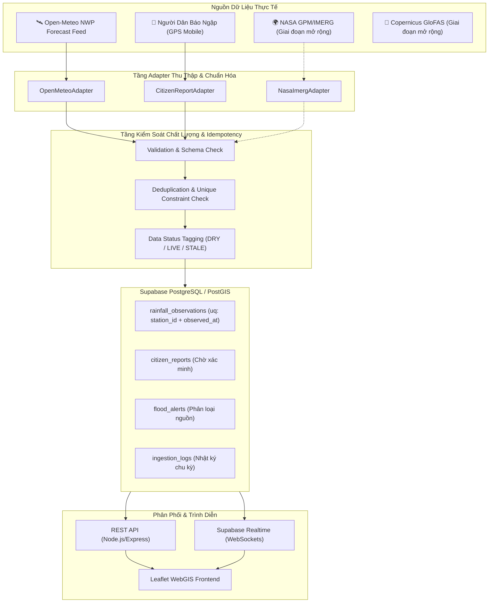

# THIẾT KẾ KIẾN TRÚC THU THẬP & XỬ LÝ DỮ LIỆU ĐỘNG
# (DYNAMIC DATA INGESTION PIPELINE SPECIFICATION)
## DỰ ÁN: VIETNAM FLOODWATCH GIS

---

## 1. TỔNG QUAN KIẾN TRÚC PIPELINE

Hệ thống xử lý dữ liệu động của **Vietnam FloodWatch GIS** được thiết kế theo mô hình **Adapter-Based Modular Pipeline** nhằm tách biệt hoàn toàn giữa nguồn cung cấp dữ liệu bên ngoài, bộ thu thập, tầng kiểm soát chất lượng và tầng lưu trữ cơ sở dữ liệu PostGIS.



---

## 2. CHI TIẾT TỪNG ADAPTER NGUỒN DỮ LIỆU

### 2.1. OpenMeteoAdapter (Dữ liệu Khí tượng Mô hình Số trị ECMWF)
- **Bản chất dữ liệu:** Dữ liệu nội suy từ mô hình dự báo số trị toàn cầu (ECMWF IFS / GFS) với độ phân giải lưới ~9km.
- **Tần suất nguồn xuất bản mới:** Cứ mỗi 1 giờ hoặc chu kỳ 15 phút nội suy.
- **Các trường thu thập:**
  - `temperature_2m` (°C)
  - `relative_humidity_2m` (%)
  - `precipitation` (mm/h)
  - `weather_code` (WMO Code 0 - 99)
  - `wind_speed_10m` (km/h)
  - `time` (Mốc thời gian gốc của mô hình - gán vào `valid_at` và `observed_at`)
- **Quy tắc chuẩn hóa lượng mưa:**
  - Nếu `precipitation === 0.0`: **Lưu giá trị 0.0 mm hợp lệ** vào CSDL với trạng thái `quality_status = 'DRY'`. Tuyệt đối không bỏ qua.
  - Nếu API mất kết nối: Ném lỗi `SOURCE_UNAVAILABLE`, ghi vào `ingestion_logs`. **Tuyệt đối không dùng dữ liệu giả fallback**.

### 2.2. CitizenCrowdsourcingAdapter (Báo cáo Cộng đồng Hiện trường)
- **Bản chất dữ liệu:** Báo cáo phản ánh từ cư dân tại hiện trường thông qua trình duyệt điện thoại di động có gắn tọa độ GPS.
- **Kiểm soát tính hợp lệ (Validation Rules):**
  - Tọa độ GPS phải nằm trong không gian lãnh thổ Việt Nam: Vĩ độ `[8.0, 24.0]`, Kinh độ `[102.0, 110.0]`.
  - Mức độ sâu ước lượng: `ANKLE` (~15cm), `HALF_WHEEL` (~35cm), `FLOOD_DEEP` (>1m).
  - Trạng thái mặc định ban đầu: `status = 'ACTIVE'`, `verification_status = 'UNVERIFIED'`.
  - Phòng chống spam / XSS: Làm sạch dữ liệu văn bản mô tả bằng `sanitize-html`, giới hạn tần suất gửi (Rate Limiting: tối đa 3 báo cáo / 10 phút từ cùng 1 địa chỉ IP).

---

## 3. THIẾT KẾ SCHEDULER ĐỘC LẬP (GIẢI PHÁP KHẮC PHỤC RENDER FREE SLEEP)

### 3.1. Phân tích bài toán
- Máy chủ **Render Web Service (Free Tier)** sẽ tự động ngủ đông (spin-down) sau 15 phút không nhận được traffic HTTP. Khi ngủ đông, các bộ đếm thời gian Node.js `setInterval` bị dừng hoàn toàn.
- Do đó, tiến trình ingestion không thể vận hành độc lập bên trong container của Render.

### 3.2. Giải pháp: GitHub Actions Scheduled Workflow (Khuyến nghị 100%)
- **Cơ chế hoạt động:**
  - Sử dụng tính năng GitHub Actions Cron có sẵn trong kho lưu trữ GitHub của bạn.
  - Workflow chạy theo chu kỳ định kỳ (ví dụ: mỗi 30 phút hoặc 60 phút).
  - Workflow thực hiện gửi một yêu cầu `HTTP POST` bảo mật tới endpoint:
    `https://hanoi-floodwatch-gis-1.onrender.com/api/ingestion/trigger`
  - Yêu cầu này tự động **đánh thức Render khỏi trạng thái ngủ đông**, sau đó thực thi một chu kỳ thu thập dữ liệu an toàn và lưu nhật ký.
- **Bảo mật Endpoint:**
  - Endpoint `/api/ingestion/trigger` được bảo vệ bằng mã định danh bí mật `INGESTION_SECRET_TOKEN` được cấu hình trong `Repository Secrets` của GitHub và biến môi trường của Render. Người lạ không thể kích hoạt bừa bãi.
- **Ưu điểm vượt trội:**
  - 100% miễn phí (GitHub cấp 2,000 phút Actions/tháng cho kho lưu trữ mã nguồn mở/công khai).
  - Minh bạch hoàn toàn: Toàn bộ lịch sử chạy, thời gian thực thi, lỗi kết nối đều hiển thị rõ ràng trên tab **Actions** của GitHub để phục vụ bảo vệ đồ án.

---

## 4. CƠ CHẾ ĐẢM BẢO TÍNH TOÀN VẸN & CHỐNG TRÙNG LẶP (IDEMPOTENT INGESTION)

1. **Ràng buộc duy nhất trên CSDL (Database Unique Constraint):**
   ```sql
   ALTER TABLE rainfall_observations 
   ADD CONSTRAINT uq_rainfall_station_time 
   UNIQUE (station_id, observed_at);
   ```
2. **Kỹ thuật Upsert an toàn:**
   - Khi quét dữ liệu thời tiết của một khu vực:
     Nếu dữ liệu thời điểm `observed_at` đã tồn tại trong CSDL, hệ thống áp dụng `ON CONFLICT (station_id, observed_at) DO NOTHING` hoặc cập nhật nếu có giá trị hiệu chỉnh mới.
   - Ngăn chặn hoàn toàn việc nhân bản bản ghi khi worker được kích hoạt nhiều lần.
3. **Bảng Nhật ký Vận hành (`ingestion_logs`):**
   - Lưu trữ lịch sử từng lần chạy: Thời điểm bắt đầu, thời điểm kết thúc, số bản ghi mới nạp thành công, số lỗi, nguồn cung cấp và trạng thái `SUCCESS / PARTIAL / FAILED`.

---

## 5. MA TRẬN VÒNG ĐỜI & TRẠNG THÁI DỮ LIỆU (DATA STATUS MATRIX)

| Trạng thái | Điều kiện xác định | Cách hiển thị trên Giao diện WebGIS |
| :--- | :--- | :--- |
| 🟢 **Dữ liệu Mới (LIVE_FRESH)** | Thời gian quan trắc cách hiện tại < 30 phút | Đèn xanh lá `● Trực tiếp`, hiển thị thông số và mốc giờ chính xác |
| 🟡 **Dữ liệu Đã Cũ (STALE)** | Thời gian quan trắc cách hiện tại từ 30 phút đến 3 giờ | Đèn vàng `Cập nhật lúc [hh:mm]`, ghi chú dữ liệu nguồn chưa có bản tin mới |
| ⚪ **Chưa Có Dữ Liệu (NO_DATA)** | Nguồn không có số liệu tại tọa độ hoặc trạm dừng phát sóng | Hiển thị chữ `--`, ghi rõ `Chưa ghi nhận dữ liệu từ nguồn` |
| 🔴 **Lỗi Kết Nối (SOURCE_ERROR)** | API nguồn trả về lỗi HTTP 5xx/4xx hoặc timeout | Biểu tượng cảnh báo, ghi rõ `Lỗi kết nối nguồn [Tên nguồn]`, KHÔNG hiển thị số liệu giả |
| 🔵 **Thời Tiết Tạnh Ráo (DRY)** | Lượng mưa đo đạc/mô hình ghi nhận = 0.0 mm/h | Hiển thị `0.0 mm/h`, nhãn `Thời tiết khô ráo, không mưa` (Giá trị hợp lệ) |
