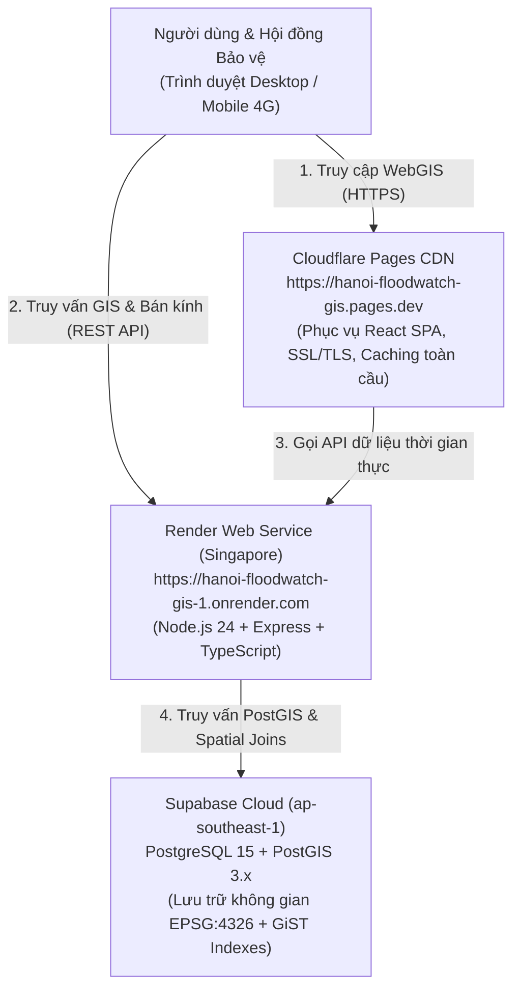

# HƯỚNG DẪN TRIỂN KHAI VÀ VẬN HÀNH HỆ THỐNG TRÊN CLOUD (DEPLOYMENT GUIDE)
## DỰ ÁN: HỆ THỐNG WEBGIS THEO DÕI VÀ CẢNH BÁO NGUY CƠ NGẬP ÚNG HÀ NỘI (HANOI FLOODWATCH GIS)

---

### 1. ĐỊA CHỈ TRUY CẬP HỆ THỐNG CHÍNH THỨC (PRODUCTION LIVE URLS)

| Thành phần hệ thống | Nền tảng Cloud | Địa chỉ truy cập chính thức | Trạng thái |
| :--- | :--- | :--- | :---: |
| **Frontend WebGIS (Bản đồ & Dashboard)** | **Cloudflare Pages** | [https://hanoi-floodwatch-gis.pages.dev](https://hanoi-floodwatch-gis.pages.dev) | 🟢 **ONLINE (24/7)** |
| **Backend REST API & PostGIS Services** | **Render Web Service** | [https://hanoi-floodwatch-gis-1.onrender.com](https://hanoi-floodwatch-gis-1.onrender.com) | 🟢 **ONLINE (24/7)** |
| **Kiểm tra sức khỏe hệ thống (Health)** | Render Web Service | [https://hanoi-floodwatch-gis-1.onrender.com/api/health](https://hanoi-floodwatch-gis-1.onrender.com/api/health) | 🟢 **200 OK** |
| **Cơ sở dữ liệu PostgreSQL + PostGIS** | **Supabase Cloud (Singapore)** | `xdjelcrhzjmnxlkbllxv.supabase.co` | 🟢 **ACTIVE** |
| **Mã nguồn dự án (GitHub)** | GitHub | [https://github.com/datwhite21/Hanoi-FloodWatch-GIS](https://github.com/datwhite21/Hanoi-FloodWatch-GIS) | 🟢 **SYNCED** |

---

### 2. KIẾN TRÚC TRIỂN KHAI ĐÁM MÂY (CLOUD ARCHITECTURE)



---

### 3. QUY TRÌNH CẤU HÌNH CHI TIẾT TRÊN CÁC NỀN TẢNG

#### 3.1. Cấu hình Backend trên Render
- **Loại dịch vụ:** Web Service
- **Vùng máy chủ (Region):** Singapore (Southeast Asia)
- **Kho lưu trữ:** `datwhite21/Hanoi-FloodWatch-GIS` (Branch: `main`)
- **Thư mục gốc (Root Directory):** `backend`
- **Lệnh biên dịch (Build Command):** `npm install --include=dev && npm run build`
- **Lệnh khởi chạy (Start Command):** `npm start`
- **Đường dẫn Health Check:** `/api/health`
- **Biến môi trường cần thiết:**
  - `NODE_ENV` = `production`
  - `PORT` = `10000`
  - `CLIENT_URL` = `https://hanoi-floodwatch-gis.pages.dev`
  - `SUPABASE_URL` = `https://xdjelcrhzjmnxlkbllxv.supabase.co`
  - `SUPABASE_ANON_KEY` = `(Khóa công khai Supabase)`
  - `SUPABASE_SERVICE_ROLE_KEY` = `(Khóa quản trị bảo mật)`

#### 3.2. Cấu hình Frontend trên Cloudflare Pages
- **Kho lưu trữ:** `datwhite21/Hanoi-FloodWatch-GIS` (Branch: `main`)
- **Thư mục gốc (Root directory):** `frontend`
- **Framework preset:** `None` (hoặc `Vite`)
- **Lệnh build:** `npm run build`
- **Thư mục đầu ra:** `dist`
- **Quy tắc định tuyến SPA:** File `frontend/public/_redirects` với nội dung `/* /index.html 200`
- **Biến môi trường:**
  - `VITE_API_URL` = `https://hanoi-floodwatch-gis-1.onrender.com/api`
  - `VITE_SUPABASE_URL` = `https://xdjelcrhzjmnxlkbllxv.supabase.co`
  - `VITE_SUPABASE_ANON_KEY` = `(Khóa công khai Supabase)`

---

### 4. QUY TRÌNH TỰ ĐỘNG TRIỂN KHAI LIÊN TỤC (CI/CD)

Mỗi khi có commit mới được đẩy lên nhánh `main` của kho GitHub `datwhite21/Hanoi-FloodWatch-GIS`:
1. **Render Webhook:** Tự động kích hoạt quy trình build lại Backend, kiểm tra TypeScript và restart tiến trình Node.js không gián đoạn dịch vụ.
2. **Cloudflare Git Integration:** Tự động phát hiện thay đổi trong thư mục `frontend/`, chạy `npm run build` và phân phối bundle mới ra hơn 300 trung tâm dữ liệu CDN của Cloudflare trên toàn thế giới trong vòng chưa đầy 1 phút.

---

### 5. HƯỚNG DẪN KIỂM TRA & GIÁM SÁT HỆ THỐNG

- **Kiểm tra API Health:**
  ```bash
  curl https://hanoi-floodwatch-gis-1.onrender.com/api/health
  ```
- **Kiểm tra truy vấn không gian trực tiếp:**
  ```bash
  curl "https://hanoi-floodwatch-gis-1.onrender.com/api/spatial/nearby?lat=21.0268&lng=105.7942&radius=2000"
  ```
- **Xử lý trạng thái ngủ đông (Sleep Mode) của gói Render Free:**
  - Máy chủ Render Free sẽ tự động tạm ngủ nếu không có request trong 15 phút.
  - Khi có request đầu tiên, máy chủ sẽ mất khoảng 30 - 50 giây để khởi động lại. Frontend đã được lập trình sẵn cơ chế hiển thị loading thân thiện để người dùng yên tâm chờ đợi.
