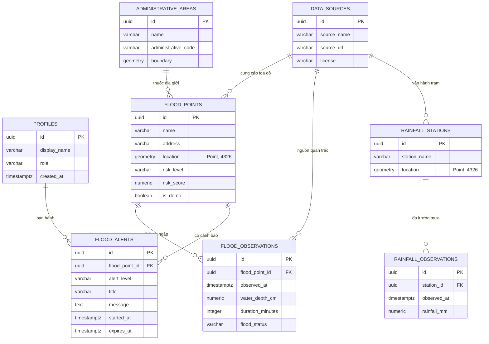
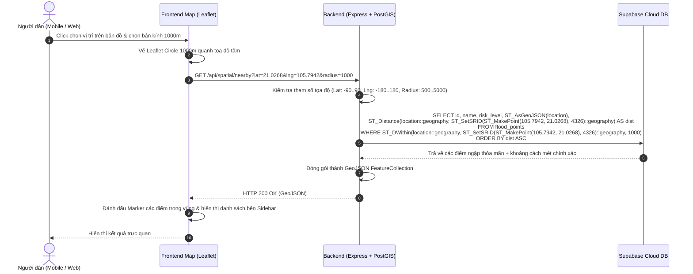
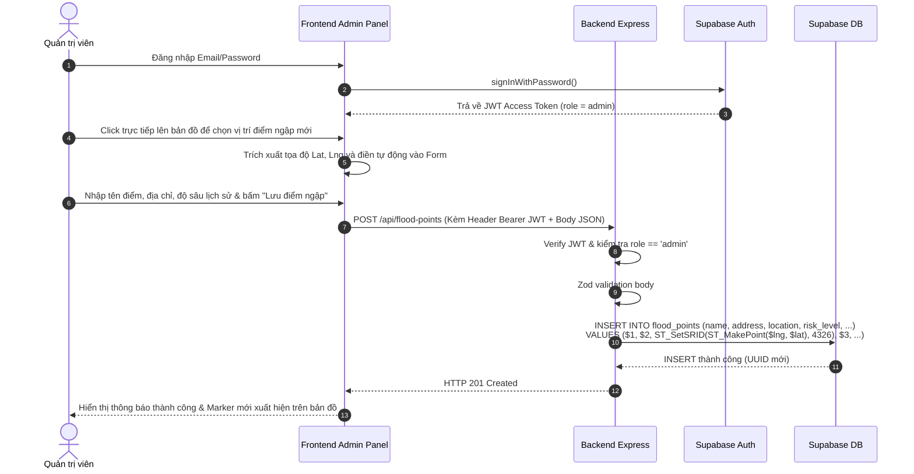

# TỔNG HỢP SƠ ĐỒ HỆ THỐNG (SYSTEM DIAGRAMS)
## DỰ ÁN: HANOI FLOODWATCH GIS

---

## 1. SƠ ĐỒ CA SỬ DỤNG (USE CASE DIAGRAM)

```mermaid
graph TD
    PublicUser((Người dùng công cộng\nCitizen/Public))
    AdminUser((Quản trị viên\nAdministrator))

    subgraph SystemBoundary ["HỆ THỐNG HANOI FLOODWATCH GIS"]
        UC1["UC-01: Xem bản đồ WebGIS trực quan"]
        UC2["UC-02: Lọc & Tìm kiếm điểm nguy cơ ngập"]
        UC3["UC-03: Xem chi tiết điểm ngập & lịch sử"]
        UC4["UC-04: Truy vấn điểm ngập theo bán kính"]
        UC5["UC-05: Tìm điểm ngập nguy cơ gần nhất"]
        UC6["UC-06: Xem Dashboard thống kê & cảnh báo"]
        UC7["UC-07: Xuất dữ liệu bản đồ GeoJSON"]
        
        UC8["UC-08: Đăng nhập quản trị (Supabase Auth)"]
        UC9["UC-09: Thêm/Sửa/Xóa điểm ngập (Click bản đồ)"]
        UC10["UC-10: Cập nhật quan trắc & độ sâu ngập"]
        UC11["UC-11: Phát hành & Hủy bỏ cảnh báo"]
        UC12["UC-12: Nhập dữ liệu không gian GeoJSON"]
    end

    PublicUser --> UC1
    PublicUser --> UC2
    PublicUser --> UC3
    PublicUser --> UC4
    PublicUser --> UC5
    PublicUser --> UC6
    PublicUser --> UC7

    AdminUser --> UC8
    AdminUser --> UC9
    AdminUser --> UC10
    AdminUser --> UC11
    AdminUser --> UC12
    AdminUser --> UC1
```

---

## 2. SƠ ĐỒ THỰC THỂ LIÊN KẾT TOÀN DIỆN (ERD DIAGRAM)

---

## 3. SƠ ĐỒ TUẦN TỰ: TRUY VẤN BÁN KÍNH KHÔNG GIAN (SPATIAL RADIUS QUERY)

---

## 4. SƠ ĐỒ TUẦN TỰ: ADMIN THÊM ĐIỂM NGẬP TỪ BẢN ĐỒ (ADMIN PINPOINT)

